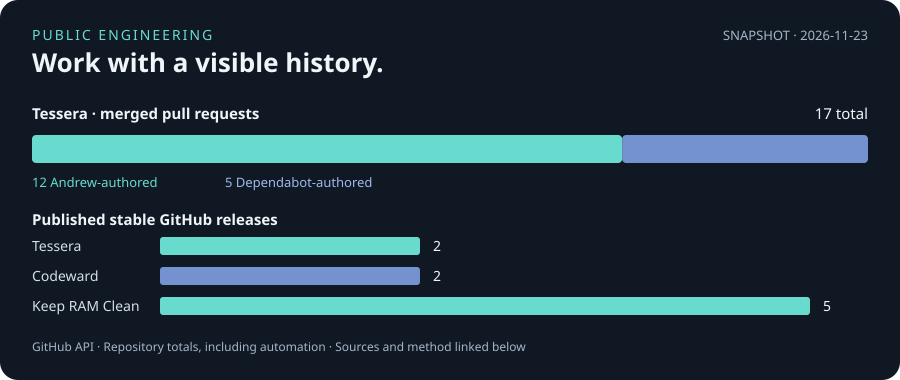

# Andrew Smith

**Domillio owner · software developer**

I own [Domillio](https://domillio.org). I'm an independent developer in Mississippi, working across web applications, practical Linux tooling, desktop software, and games.

I'm interested in both sides of software: the systems underneath it and what it feels like to use. Rust, persistent state, window-management behavior, and low-level interfaces sit alongside web UX, clear workflows, and useful exports.

## Domillio

**Shopify-focused document workflows**

My work on Domillio centers on tax-exemption certificates, product-safety documents, and disclosure workflows. I care about making complicated records easier to collect, review, and understand.

The [public browser demos](https://domillio.org/demos) show sample workflows. They aren't real merchant approvals or proof of production readiness; the underlying products are still in development or review.

## [Tessera](https://github.com/Andrew-Smith-93/Tessera)
**Keyboard-driven tiling inside KDE Plasma 6**

Tessera runs inside KWin rather than replacing the desktop. It combines deterministic snap-region layouts, keyboard controls, and multi-monitor behavior. The details matter here: keeping a window on the intended display, preserving a deliberate resize, and stopping animation writes when a window enters fullscreen.

[Public release v1.0.2](https://github.com/Andrew-Smith-93/Tessera/releases/tag/v1.0.2) · [Installation & architecture](https://github.com/Andrew-Smith-93/Tessera#readme) · [Desktop screenshot](https://github.com/Andrew-Smith-93/Tessera/blob/main/docs/screenshots/tessera-multiscreen-live.png)

## [Codeward](https://github.com/Andrew-Smith-93/codeward)
**AI-assisted code review tooling**

A collaborative TypeScript project with a CLI and GitHub Action for reviewing diffs. It explores specialized review passes and bringing their findings back into a usable workflow. Automated findings still need human judgment.

## Browser tools
**Small applications with a clear purpose**

Fieldwork covers contractor jobs and estimates; Table focuses on CSV preparation; Outline supports writing and revisions. These are local browser apps with exports, not hosted team platforms or payment systems. The collection also includes prototypes and visual experiments.

## Engineering in public

A small, verifiable snapshot of the public repositories, not a popularity score.

The chart counts repository activity, not users, revenue, test coverage, or all of my work. [Sources, exact counts, and methodology](stats/public-engineering.md).

## Languages in my public repositories

This live third-party card measures public, non-forked code size, not proficiency or time spent. It excludes private projects and work in other owners' repositories.

[GitHub contribution history](https://github.com/Andrew-Smith-93?tab=overview) is a separate view of activity, not a measure of software quality.

## Beyond the public repositories

- **Bridge:** a local desktop console for agent activity, messages, and worktree review, with native and x86-64 assembly work in its preview.
- **Anvil:** a pre-release Rust job queue for Linux, backed by SQLite and designed for a single machine.
- **Dies Irae & Lanternbound:** Godot game projects exploring action-roguelike and companion-card mechanics.

These projects are still in development and their source is private. I don't treat a prototype, a simulation, and a shipped release as interchangeable.

## How I approach the work

I like software that behaves predictably and makes its state understandable. An original CSV should survive an edit. An export should match what was reviewed. A window should stay on the right monitor.

I use AI tools alongside code review, tests, and hands-on debugging. The interesting part isn't generating more code; it's deciding what belongs, finding what breaks, and making the result coherent.

**Technical interests:** Rust · TypeScript / JavaScript · Linux / KWin · SQLite · Godot / GDScript · x86-64 assembly · web UX

[andrewsmith.app](https://andrewsmith.app)
