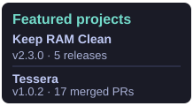
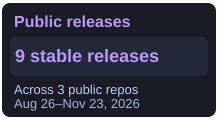

**Andrew Smith**

Linux tools and desktop software · [Domillio](https://domillio.org) · [Full text version](profile-text.md)

 

 

[andrewsmith.app](https://andrewsmith.app) · [Stats sources](stats/public-engineering.md) · [Contribution history](https://github.com/Andrew-Smith-93?tab=overview)
