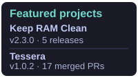
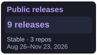
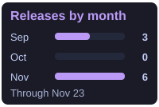
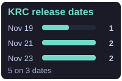
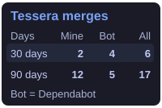

**Andrew Smith**

Linux tools and desktop software · [Domillio](https://domillio.org) · [Full text version](profile-text.md) · [Sponsor](https://github.com/sponsors/Andrew-Smith-93?o=esb)

 

 

 

 

**Release notes:** [Keep RAM Clean v2.2.1](https://github.com/Andrew-Smith-93/keep-ram-clean/releases/tag/v2.2.1) fixed Debian 12 amd64 packaging; [v2.3.0](https://github.com/Andrew-Smith-93/keep-ram-clean/releases/tag/v2.3.0) added opt-in workload discovery. [Tessera v1.0.2](https://github.com/Andrew-Smith-93/Tessera/releases/tag/v1.0.2) added shortcut settings and fixed snapping on stacked monitors.

[Data and definitions](stats/public-engineering.md#release-cadence)

[andrewsmith.app](https://andrewsmith.app) · [Stats sources](stats/public-engineering.md) · [Contribution history](https://github.com/Andrew-Smith-93?tab=overview)
