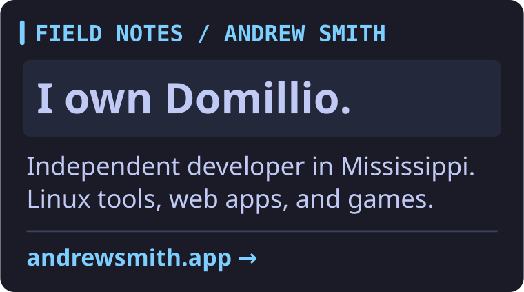
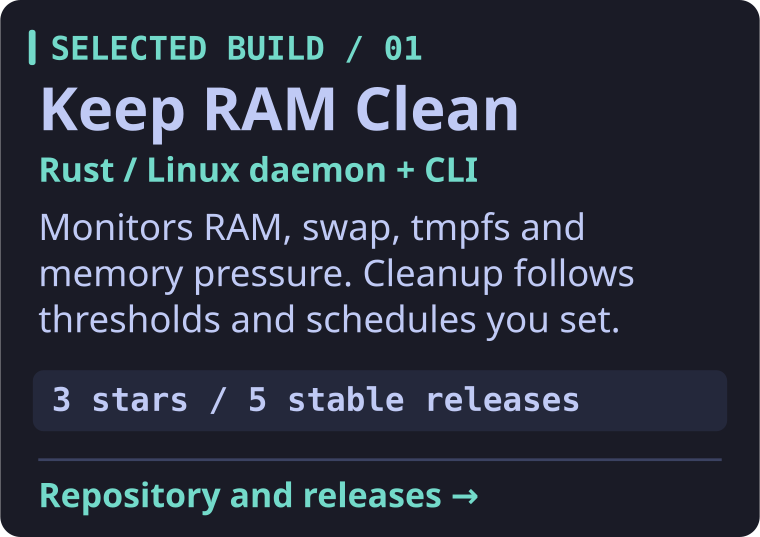
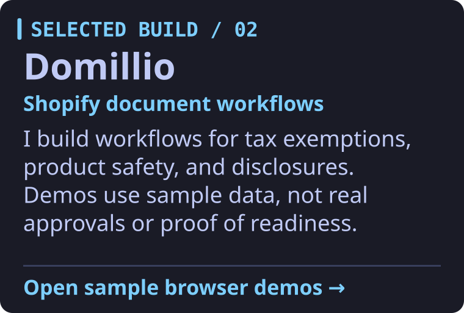
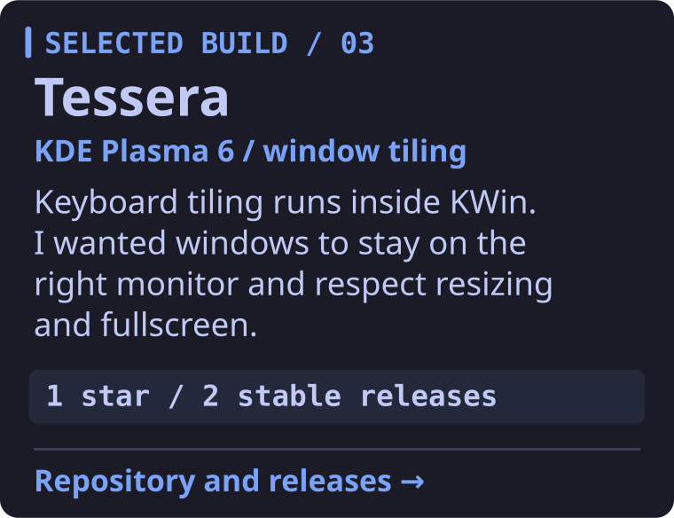
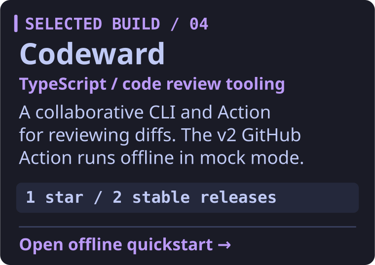
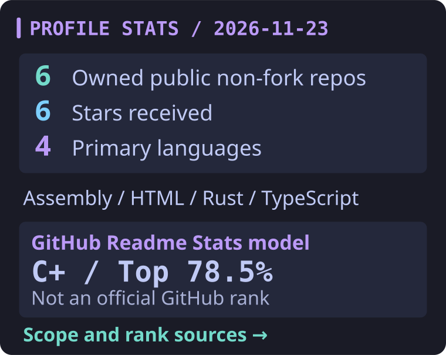
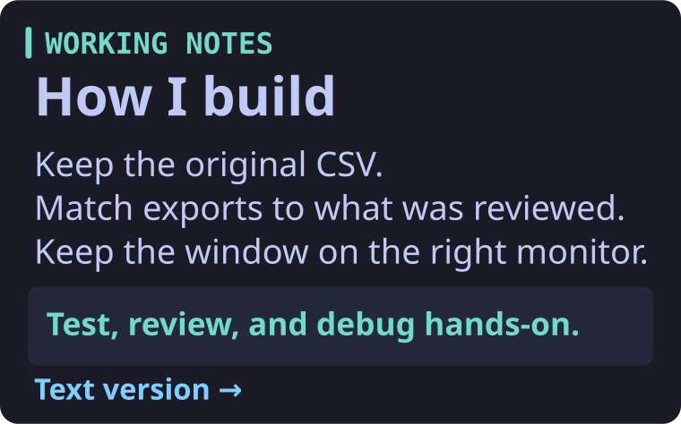

# Andrew Smith

[Full text version and project links](profile-text.md) · [Stats sources](stats/public-engineering.md)

## Selected builds

## Engineering in public

## Profile stats

## Under construction

## How I build

[Full text version](profile-text.md) · [GitHub contribution history](https://github.com/Andrew-Smith-93?tab=overview)
